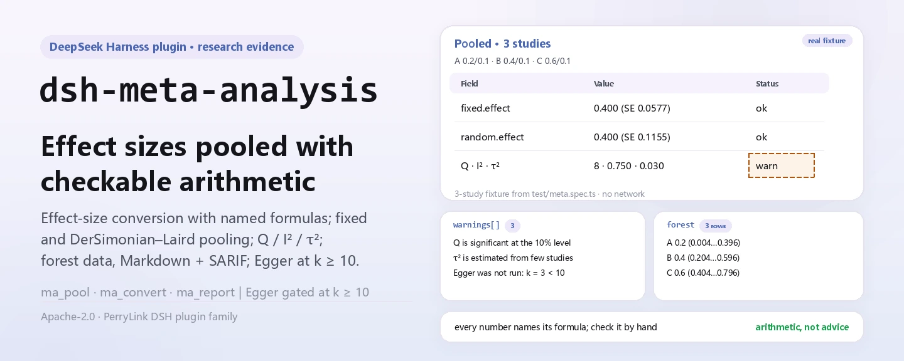
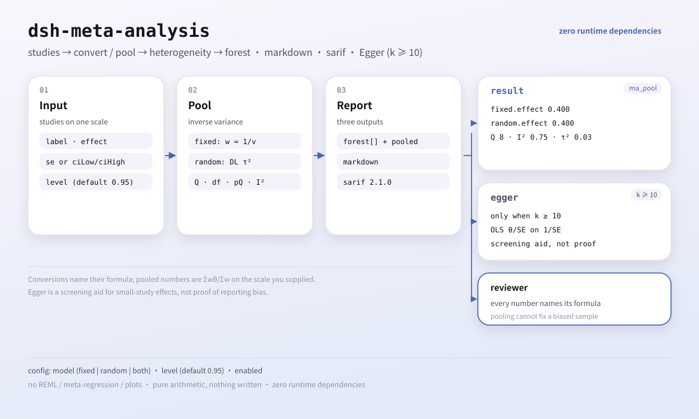
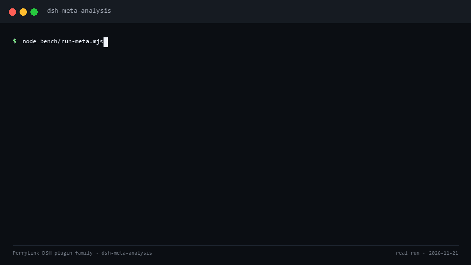

<div align="center">

<picture>
  <source media="(prefers-color-scheme: dark)" srcset="docs/assets/dsh-meta-analysis-hero-en-dark.webp">
  
</picture>

# dsh-meta-analysis

**Agrupa los tamaños de efecto — con una aritmética que puedes comprobar línea por línea.**

*Conversión de tamaños de efecto con fórmulas con nombre, agrupación de efectos fijos y aleatorios de DerSimonian–Laird, Q / I² / τ², datos de forest plot, Markdown + SARIF y una prueba de Egger ligera que se niega a ejecutarse con menos de diez estudios.*

[English](README.md) · [简体中文](README-zh.md) · [Español](README-es.md) · [Português](README-pt.md) · [हिन्दी](README-hi.md)

[](LICENSE)
[]()

</div>

---

## Qué hace

- **`ma_pool`** — agrupación por varianza inversa en una sola escala de análisis. Fijo: `w = 1/v`, agrupado `Σwθ/Σw`, `SE = 1/√Σw`. Aleatorio: `τ²` de DerSimonian–Laird, pesos `1/(v+τ²)`. Informa Q, df, p, I², τ², los pesos por estudio y la CI/p agrupadas en el nivel de confianza solicitado (`level`, por defecto 0.95).
- **`ma_convert`** — OR⇄logOR, RR⇄logRR (SE a partir de una CI), d⇄r, d⇄OR (aproximación logística), SMD a partir de dos medias, SE a partir de una CI. Cada resultado nombra la fórmula y cualquier aproximación.
- **`ma_report`** — datos de forest plot independientes del renderizador (efecto, CI, % de peso + fila agrupada), Markdown, SARIF 2.1.0.
- **Egger** — solo con k ≥ 10: MCO de θᵢ/SEᵢ sobre 1/SEᵢ; la intersección contrasta los efectos de estudios pequeños. Se etiqueta como ayuda de cribado, no como prueba de sesgo de publicación.


<picture>
  <source media="(prefers-color-scheme: dark)" srcset="docs/assets/dsh-meta-analysis-flow-v5-dark.svg">
  
</picture>

*Estructura: entrada → agrupación → informe; `result`, `markdown` y `sarif` son las salidas, y un `level` distinto de 0.95 se respeta en todo. Las etiquetas de token dentro del diagrama son los nombres reales de las herramientas y de los campos, así que la misma imagen sirve para los cinco idiomas.*

## Qué no hace

- **Ningún ajuste de modelo más allá de DL.** Sin REML/Paule–Mandel, sin meta-regresión, sin automatización de subgrupos ni de leave-one-out (las entradas las varías tú), sin trim-and-fill.
- **Sin juicio de riesgo de sesgo.** Los pesos no codifican la calidad del estudio.
- **Sin extracción de datos.** Los tamaños de efecto y sus SE deben aportarse en una sola escala; `ma_convert` ayuda a producirlos.
- **Sin gráficos.** Se ofrecen los datos del forest plot; el dibujo pertenece al host u otra herramienta.
- **Sin almacén de evidencia.** Este plugin es aritmética pura: no escribe nada en disco y el README lo dice en lugar de fingir que existe un registro REP.

## Fórmulas

| Cantidad | Fórmula |
|---|---|
| Efecto fijo agrupado | `Σwᵢθᵢ / Σwᵢ`, `wᵢ = 1/vᵢ` |
| Efecto aleatorio agrupado | igual con `wᵢ* = 1/(vᵢ + τ²)` |
| Q | `Σ wᵢ(θᵢ − θ_FE)²`, df = k−1 |
| I² | `max(0, (Q − df)/Q)` |
| τ² (DL) | `max(0, (Q − df)/(Σw − Σw²/Σw))` |
| SE a partir de CI | `(high − low)/(2·z)` |
| d→r | `d/√(d²+4)` |
| d⇄OR | `exp(d·π/√3)` / `log(OR)·√3/π` |
| SMD | `(m₁−m₂)/s_pooled`, SE `√(1/n₁+1/n₂+d²/(2(n₁+n₂)))` |
| Egger | intersección MCO de `θᵢ/SEᵢ` sobre `1/SEᵢ`, t con df = k−2 |

La p de cola normal usa una aproximación A&S 7.1.26 (~1e-7); Φ⁻¹ usa AS 241 / PPND16 de Wichura (~1e-16); χ² y t usan fracciones continuas de gamma/beta incompletas regularizadas (~1e-10). Todo está implementado en `src/math.ts` sin dependencias.

## Herramientas

### `ma_pool`

`{ studies: [{label, effect, se?, ciLow?, ciHigh?}], model?, level? }` → `{ ok, result }`.

### `ma_convert`

`{ conversion, value?, low?, high?, level?, mean1?, sd1?, n1?, mean2?, sd2?, n2? }` → `{ ok, result }`.

### `ma_report`

`{ result, measure? }` → `{ ok, forest, markdown, sarif }`.

### Códigos de error

`INVALID_INPUT` (valores no finitos, SE/OR/RR no positivos, |r| ≥ 1, desacuerdo SE/CI, k < 2).

## Compatibilidad e instalación

| | |
|---|---|
| DeepSeek Harness | **`dsh-v0.2.2-rc.4`** (verificado 2026-11-18); peer `>=0.2.1-0 <0.3.0 \|\| >=0.2.2-0 <0.3.0` |
| Node | `^22.19.0 \|\| >=24.9.0` (probado en `24.22.1`), solo ESM |
| Peers | `@perrylink/dsh-research-core ^0.1.0`, `@deepseek-ai/cordis ^4.0.5-alpha.1`, `@deepseek-ai/dsh-tools`, `@deepseek-ai/schemastery ^3.18.5-alpha.1` |
| Dependencias en tiempo de ejecución | **cero** |

```sh
dsh plugin --profile <name> add @perrylink/dsh-research-core dsh-meta-analysis
dsh --profile <name> --dump-config | grep dsh-meta-analysis
```


> **Nota sobre el peer común a la familia:** `@perrylink/dsh-research-core` se declara como peer por un contrato de instalación único y uniforme en toda la familia de investigación, aunque este paquete no lo importe en tiempo de ejecución.

## Configuración

| Clave | Por defecto | Significado |
|---|---|---|
| `enabled` | `true` | `false` no monta nada |
| `model` | `both` | modelo de agrupación por defecto (`fixed` / `random` / `both`) |
| `level` | `0.95` | nivel de confianza por defecto |

## Evaluación



*Animado: la stdout real del adaptador del benchmark sobre los fixtures congelados (sin red; reejecutado el 2026-11-21). Los valores esperados son la forma cerrada independiente del generador, no la salida del plugin.*


**23 pruebas unitarias**: funciones especiales frente a valores críticos conocidos (χ²(8,2)=0.9817, t(2.306,8)≈0.05, z(1.96)≈0.05, Φ⁻¹(0.975) con 12 decimales), conversiones (logOR+SE, d⇄r, d⇄OR, SMD, entradas imposibles), agrupación (estimaciones fijo/aleatorio calculadas a mano, Q=8, I²=0.75, τ²=0.03 con tres estudios), el nivel de confianza solicitado para las CI agrupadas y por estudio, SE derivada de la CI y rechazo de un desacuerdo SE/CI, modelos/niveles/estudios inválidos, el gating de Egger en k=10, advertencias de heterogeneidad, esquemas de herramientas, rechazo de informes malformados, informe de extremo a extremo, contrato del plugin, contrato del paquete y contrato de montaje habilitado/deshabilitado.

### Benchmark sintético de meta-análisis

**20 casos sintéticos deterministas** (conjunto de datos `meta` v0.1.0, congelado) en el repositorio hermano `dsh-research-bench`, bajo `data/meta`; no se incluye en este paquete. Cada caso aporta estudios (efecto + SE, o una CI simétrica) y valores esperados en forma cerrada para la agrupación fija/aleatoria, Q, df, pQ, I², τ² y la presencia de Egger.

Cobertura: 5 casos homogéneos (I²=0, τ²=0), 5 de heterogeneidad media y 4 alta (Q>df, τ²>0), 2 de efecto cero, 2 de efecto negativo y 2 de k pequeño; k = 2 (4 casos), 5 (5), 10 (6) y 12 (5); 10 diseños con SE iguales y 10 con SE distintas; entradas solo SE, solo CI y mixtas. Egger se ejecuta en los 11 casos con k ≥ 10 (incluido el límite k=10) y en ninguno de los 9 por debajo.

El adaptador llama a `pool(studies, { model: 'both' })` y compara con la implementación independiente del generador (sin importar el plugin ni derivar valores esperados de su salida). **20/20 casos pasan**; errores absolutos:

| Cantidad | Error absoluto máx. | Error absoluto medio | Tolerancia |
|---|---:|---:|---:|
| efecto fijo/aleatorio | 1.11e-16 | 8.33e-18 | 1e-6 |
| SE fija/aleatoria | 2.78e-17 | 1.74e-18 | 1e-6 |
| CI fija/aleatoria | 2.22e-16 | 3.96e-17 | 1e-6 |
| Q | 8.53e-14 | 7.58e-15 | 1e-6 |
| τ² | 8.33e-17 | 6.72e-18 | 1e-6 |
| I² | 2.22e-16 | 1.94e-17 | 1e-9 |
| pQ | 1.67e-15 | 1.96e-16 | 1e-9 |

El benchmark reveló un límite de precisión real: el antiguo Φ⁻¹ de Acklam se desviaba 1.6e-9 en el 95 %, y las SE derivadas de la CI amplificaban esa desviación hasta 1.12e-9 en la I² de dos casos. `normalQuantile` usa ahora AS 241; el error máximo de Q es 8.5e-14.

```sh
pnpm run build
pnpm run bench:meta        # lee ../dsh-research-bench/data/meta (BENCH_DIR lo sobrescribe)
```

Escribe `bench/results-meta.json` y `bench/results-meta.md` (sin marcas de tiempo; volver a ejecutarlo es idéntico byte a byte).

## Limitaciones conocidas (v0.1)

- Una sola escala de análisis por llamada; la armonización multi-escala corresponde a quien llama.
- Se sabe que el τ² de DL está sesgado con k pequeño; el plugin avisa cuando k < 5.
- La prueba de Egger asume una distribución normal de los efectos y tiene poca potencia por debajo de ~10 estudios.
- Sin intervalo de predicción (podría añadirse sin cambiar la interfaz).

## Licencia

Apache-2.0. Sin código de terceros en tiempo de ejecución.
