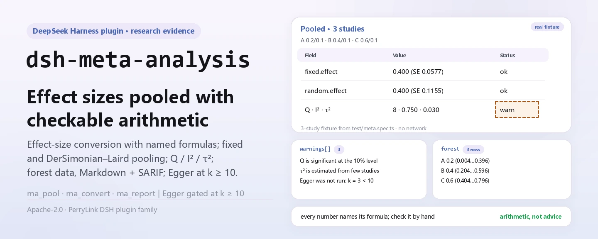
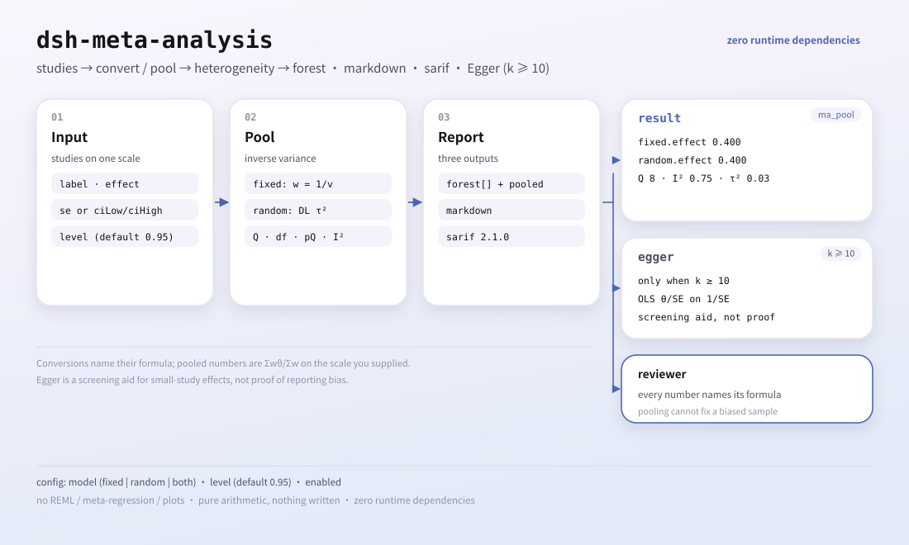
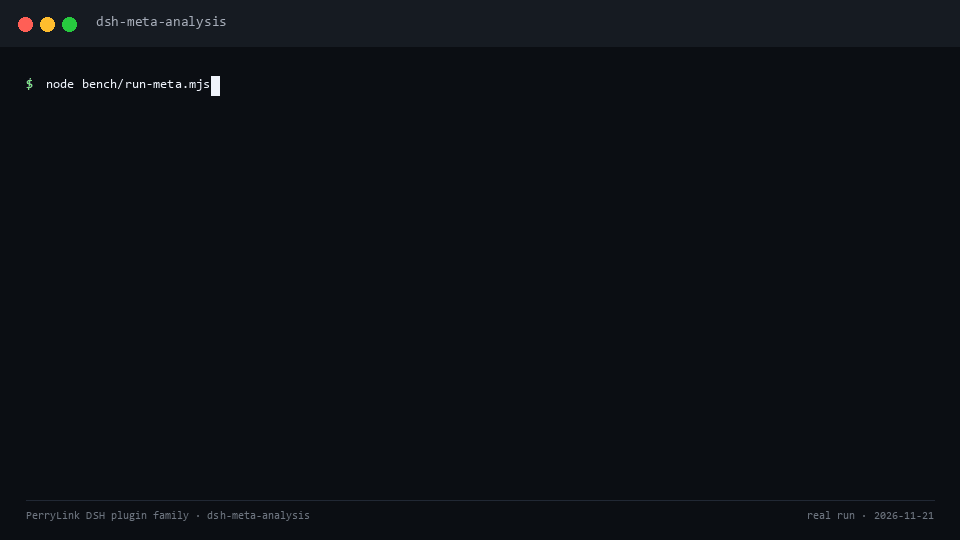

<div align="center">

<picture>
  <source media="(prefers-color-scheme: dark)" srcset="docs/assets/dsh-meta-analysis-hero-en-dark.webp">
  
</picture>

# dsh-meta-analysis

**प्रभाव आकारों को संयोजित करें — ऐसे अंकगणित से जिसे आप पंक्ति-दर-पंक्ति जाँच सकें।**

*नामित सूत्रों के साथ प्रभाव-आकार रूपांतरण, निश्चित-प्रभाव और DerSimonian–Laird यादृच्छिक-प्रभाव संयोजन, Q / I² / τ², forest plot डेटा, Markdown + SARIF, और एक हल्का Egger परीक्षण जो दस से कम अध्ययनों पर चलने से इनकार करता है।*

[English](README.md) · [简体中文](README-zh.md) · [Español](README-es.md) · [Português](README-pt.md) · [हिन्दी](README-hi.md)

[](LICENSE)
[]()

</div>

---

## यह क्या करता है

- **`ma_pool`** — एक ही विश्लेषण-पैमाने पर व्युत्क्रम-विचरण संयोजन। निश्चित: `w = 1/v`, संयोजित `Σwθ/Σw`, `SE = 1/√Σw`। यादृच्छिक: DerSimonian–Laird `τ²`, भार `1/(v+τ²)`। Q, df, p, I², τ², प्रति-अध्ययन भार और अनुरोधित विश्वास स्तर (`level`, डिफ़ॉल्ट 0.95) पर संयोजित CI/p रिपोर्ट करता है।
- **`ma_convert`** — OR⇄logOR, RR⇄logRR (CI से SE), d⇄r, d⇄OR (लॉजिस्टिक सन्निकटन), दो माध्यों से SMD, CI से SE। हर परिणाम सूत्र और किसी भी सन्निकटन का नाम बताता है।
- **`ma_report`** — रेंडरर-निरपेक्ष forest plot डेटा (प्रभाव, CI, भार % + संयोजित पंक्ति), Markdown, SARIF 2.1.0।
- **Egger** — केवल k ≥ 10 पर: `θᵢ/SEᵢ` का `1/SEᵢ` पर OLS; अंतःखंड छोटे-अध्ययन प्रभावों की जाँच करता है। इसे स्क्रीनिंग सहायता कहा गया है, प्रकाशन-पूर्वाग्रह का प्रमाण नहीं।


<picture>
  <source media="(prefers-color-scheme: dark)" srcset="docs/assets/dsh-meta-analysis-flow-v5-dark.svg">
  
</picture>

*संरचना: इनपुट → संयोजन → रिपोर्ट; `result`, `markdown` और `sarif` तीन आउटपुट हैं, और 0.95 से भिन्न `level` हर जगह लागू होता है। डायग्राम के अंदर टोकन लेबल असली टूल और फ़ील्ड नाम हैं, इसलिए एक ही चित्र पाँचों भाषाओं के लिए काम आता है।*

## यह क्या नहीं करता

- **DL से आगे कोई मॉडल फ़िटिंग नहीं।** कोई REML/Paule–Mandel नहीं, कोई मेटा-रिग्रेशन नहीं, उपसमूह या leave-one-out का कोई स्वचालन नहीं (इनपुट आपके हाथ में हैं), कोई trim-and-fill नहीं।
- **पूर्वाग्रह-जोखिम का कोई निर्णय नहीं।** भार अध्ययन की गुणवत्ता नहीं दर्शाते।
- **कोई डेटा निष्कर्षण नहीं।** प्रभाव आकार और SE एक ही पैमाने पर देने होंगे; `ma_convert` उन्हें बनाने में मदद करता है।
- **कोई प्लॉट नहीं।** forest plot डेटा दिया जाता है; चित्र बनाना होस्ट या किसी अन्य टूल का काम है।
- **कोई एविडेंस स्टोर नहीं।** यह प्लगइन शुद्ध अंकगणित है: डिस्क पर कुछ नहीं लिखा जाता, और README यही कहता है बजाय REP रिकॉर्ड होने का दिखावा करने के।

## सूत्र

| मात्रा | सूत्र |
|---|---|
| निश्चित संयोजित | `Σwᵢθᵢ / Σwᵢ`, `wᵢ = 1/vᵢ` |
| यादृच्छिक संयोजित | वही, `wᵢ* = 1/(vᵢ + τ²)` के साथ |
| Q | `Σ wᵢ(θᵢ − θ_FE)²`, df = k−1 |
| I² | `max(0, (Q − df)/Q)` |
| τ² (DL) | `max(0, (Q − df)/(Σw − Σw²/Σw))` |
| CI से SE | `(high − low)/(2·z)` |
| d→r | `d/√(d²+4)` |
| d⇄OR | `exp(d·π/√3)` / `log(OR)·√3/π` |
| SMD | `(m₁−m₂)/s_pooled`, SE `√(1/n₁+1/n₂+d²/(2(n₁+n₂)))` |
| Egger | `θᵢ/SEᵢ` का `1/SEᵢ` पर OLS अंतःखंड, t के साथ df = k−2 |

सामान्य-पुच्छ p, A&S 7.1.26 सन्निकटन (~1e-7) का उपयोग करता है; Φ⁻¹, Wichura के AS 241 / PPND16 (~1e-16) का; χ² और t नियमितीकृत अपूर्ण गामा/बीटा सतत भिन्नों (~1e-10) का। सब कुछ `src/math.ts` में बिना किसी निर्भरता के लागू है।

## टूल

### `ma_pool`

`{ studies: [{label, effect, se?, ciLow?, ciHigh?}], model?, level? }` → `{ ok, result }`.

### `ma_convert`

`{ conversion, value?, low?, high?, level?, mean1?, sd1?, n1?, mean2?, sd2?, n2? }` → `{ ok, result }`.

### `ma_report`

`{ result, measure? }` → `{ ok, forest, markdown, sarif }`.

### त्रुटि कोड

`INVALID_INPUT` (अंतिम-न-होने वाले मान, गैर-धनात्मक SE/OR/RR, |r| ≥ 1, SE/CI में असंगति, k < 2)।

## अनुकूलता और इंस्टॉल

| | |
|---|---|
| DeepSeek Harness | **`dsh-v0.2.2-rc.4`** (2026-11-18 को सत्यापित); peer `>=0.2.1-0 <0.3.0 \|\| >=0.2.2-0 <0.3.0` |
| Node | `^22.19.0 \|\| >=24.9.0` (`24.22.1` पर परीक्षित), केवल ESM |
| Peers | `@perrylink/dsh-research-core ^0.1.0`, `@deepseek-ai/cordis ^4.0.5-alpha.1`, `@deepseek-ai/dsh-tools`, `@deepseek-ai/schemastery ^3.18.5-alpha.1` |
| रनटाइम निर्भरताएँ | **शून्य** |

```sh
dsh plugin --profile <name> add @perrylink/dsh-research-core dsh-meta-analysis
dsh --profile <name> --dump-config | grep dsh-meta-analysis
```


> **पूरे परिवार के साझा peer पर नोट:** `@perrylink/dsh-research-core` को पूरे रिसर्च परिवार में एक समान इंस्टॉल अनुबंध के लिए peer घोषित किया गया है, भले ही यह पैकेज रनटाइम पर उसे इंपोर्ट न करे।

## कॉन्फ़िगरेशन

| कुंजी | डिफ़ॉल्ट | अर्थ |
|---|---|---|
| `enabled` | `true` | `false` पर कुछ भी माउंट नहीं होता |
| `model` | `both` | डिफ़ॉल्ट संयोजन मॉडल (`fixed` / `random` / `both`) |
| `level` | `0.95` | डिफ़ॉल्ट विश्वास स्तर |

## मूल्यांकन



*एनिमेटेड: फ़्रोज़न फ़िक्सचरों पर बेंचमार्क एडाप्टर का असली stdout (कोई नेटवर्क नहीं; 2026-11-21 को दोबारा चलाया गया)। अपेक्षित मान जनरेटर का स्वतंत्र बंद-रूप हैं, प्लगइन का आउटपुट नहीं।*


**23 यूनिट टेस्ट**: ज्ञात क्रिटिकल मानों के विरुद्ध विशेष फ़ंक्शन (χ²(8,2)=0.9817, t(2.306,8)≈0.05, z(1.96)≈0.05, Φ⁻¹(0.975) 12 दशमलव तक), रूपांतरण (logOR+SE, d⇄r, d⇄OR, SMD, असंभव इनपुट), संयोजन (हाथ से गणना किए गए निश्चित/यादृच्छिक अनुमान, तीन अध्ययनों से Q=8, I²=0.75, τ²=0.03), संयोजित और प्रति-अध्ययन CI के लिए अनुरोधित विश्वास स्तर, CI से व्युत्पन्न SE और SE/CI असंगति की अस्वीकृति, अमान्य मॉडल/स्तर/अध्ययन, k=10 पर Egger का गेटिंग, विषमता चेतावनियाँ, टूल स्कीमा, विकृत रिपोर्ट की अस्वीकृति, एंड-टू-एंड रिपोर्ट, प्लगइन अनुबंध, पैकेज अनुबंध और सक्षम/अक्षम माउंट अनुबंध।

### सिंथेटिक मेटा-विश्लेषण बेंचमार्क

**20 केसों का नियतात्मक सिंथेटिक बेंचमार्क** (डेटासेट `meta` v0.1.0, फ़्रोज़न) सहोदर रिपॉज़िटरी `dsh-research-bench` में `data/meta` के अंतर्गत है; इसे इस पैकेज में शामिल नहीं किया गया। हर केस अध्ययन (प्रभाव + SE, या एक सममित CI) और निश्चित/यादृच्छिक संयोजन, Q, df, pQ, I², τ² तथा Egger की उपस्थिति के लिए बंद-रूप अपेक्षित मान देता है।

कवरेज: 5 समरूप केस (I²=0, τ²=0), 5 मध्यम और 4 उच्च विषमता वाले (Q>df, τ²>0), 2 शून्य-प्रभाव, 2 ऋणात्मक-प्रभाव और 2 छोटे-k केस; k = 2 (4 केस), 5 (5), 10 (6) और 12 (5); 10 समान-SE और 10 असमान-SE डिज़ाइन; केवल-SE, केवल-CI और मिश्रित इनपुट। Egger उन 11 केसों पर चलता है जहाँ k ≥ 10 है (k=10 की सीमा सहित) और नीचे के 9 में से किसी पर नहीं।

एडाप्टर `pool(studies, { model: 'both' })` को कॉल करता है और जनरेटर के स्वतंत्र कार्यान्वयन से तुलना करता है (कोई प्लगइन इंपोर्ट नहीं, कोई अपेक्षित मान प्लगइन आउटपुट से नहीं लिया गया)। **20/20 केस पास**; निरपेक्ष त्रुटियाँ:

| मात्रा | अधिकतम निरपेक्ष त्रुटि | औसत निरपेक्ष त्रुटि | सहनशीलता |
|---|---:|---:|---:|
| निश्चित/यादृच्छिक प्रभाव | 1.11e-16 | 8.33e-18 | 1e-6 |
| निश्चित/यादृच्छिक SE | 2.78e-17 | 1.74e-18 | 1e-6 |
| निश्चित/यादृच्छिक CI | 2.22e-16 | 3.96e-17 | 1e-6 |
| Q | 8.53e-14 | 7.58e-15 | 1e-6 |
| τ² | 8.33e-17 | 6.72e-18 | 1e-6 |
| I² | 2.22e-16 | 1.94e-17 | 1e-9 |
| pQ | 1.67e-15 | 1.96e-16 | 1e-9 |

बेंचमार्क ने एक असली सटीकता-सीमा उजागर की: पुराना Acklam Φ⁻¹ 95% पर 1.6e-9 भटकता था, और CI से व्युत्पन्न SE ने उसे दो केसों की I² में 1.12e-9 के विचलन तक बढ़ा दिया। अब `normalQuantile` AS 241 का उपयोग करता है; Q की अधिकतम त्रुटि 8.5e-14 है।

```sh
pnpm run build
pnpm run bench:meta        # ../dsh-research-bench/data/meta पढ़ता है (BENCH_DIR ओवरराइड करता है)
```

यह `bench/results-meta.json` और `bench/results-meta.md` लिखता है (कोई टाइमस्टैम्प नहीं; दोबारा चलाने पर बाइट-दर-बाइट समान)।

## ज्ञात सीमाएँ (v0.1)

- प्रति कॉल एक ही विश्लेषण-पैमाना; बहु-पैमाना सामंजस्य कॉलर का काम है।
- DL का τ² छोटे k पर पक्षपाती माना जाता है; प्लगइन k < 5 पर चेतावनी देता है।
- Egger परीक्षण प्रभावों का सामान्य वितरण मानता है और ~10 अध्ययनों से नीचे कम शक्ति वाला है।
- कोई भविष्यवाणी अंतराल नहीं (इंटरफ़ेस बदले बिना जोड़ा जा सकता है)।

## लाइसेंस

Apache-2.0. रनटाइम पर कोई तृतीय-पक्ष कोड नहीं।
