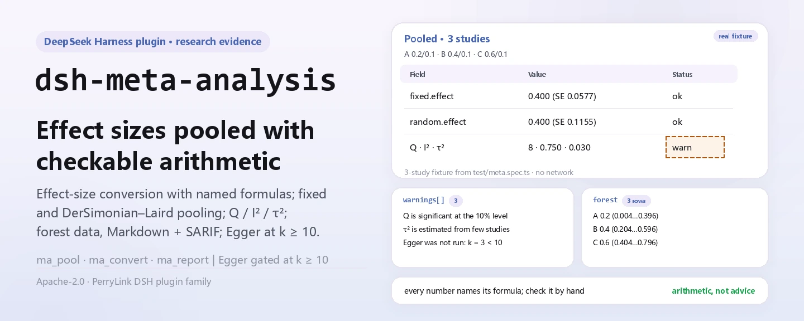
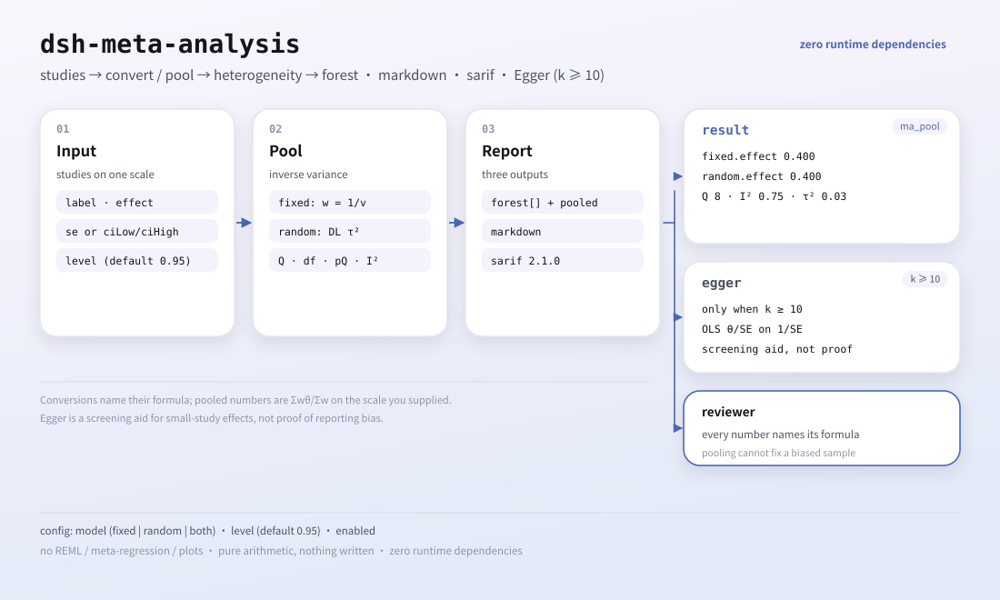
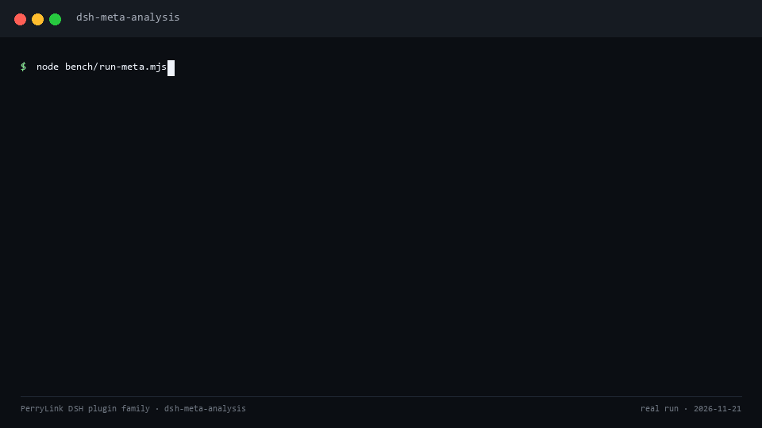

<div align="center">

<picture>
  <source media="(prefers-color-scheme: dark)" srcset="docs/assets/dsh-meta-analysis-hero-en-dark.webp">
  
</picture>

# dsh-meta-analysis

**Agrupe os tamanhos de efeito — com uma aritmética que você pode conferir linha por linha.**

*Conversão de tamanhos de efeito com fórmulas nomeadas, agrupamento de efeitos fixos e aleatórios de DerSimonian–Laird, Q / I² / τ², dados de forest plot, Markdown + SARIF e um teste de Egger leve que se recusa a rodar com menos de dez estudos.*

[English](README.md) · [简体中文](README-zh.md) · [Español](README-es.md) · [Português](README-pt.md) · [हिन्दी](README-hi.md)

[](LICENSE)
[]()

</div>

---

## O que faz

- **`ma_pool`** — agrupamento por variância inversa em uma única escala de análise. Fixo: `w = 1/v`, agrupado `Σwθ/Σw`, `SE = 1/√Σw`. Aleatório: `τ²` de DerSimonian–Laird, pesos `1/(v+τ²)`. Reporta Q, df, p, I², τ², os pesos por estudo e a CI/p agrupadas no nível de confiança solicitado (`level`, padrão 0.95).
- **`ma_convert`** — OR⇄logOR, RR⇄logRR (SE a partir de uma CI), d⇄r, d⇄OR (aproximação logística), SMD a partir de duas médias, SE a partir de uma CI. Todo resultado nomeia a fórmula e qualquer aproximação.
- **`ma_report`** — dados de forest plot independentes do renderizador (efeito, CI, % de peso + linha agrupada), Markdown, SARIF 2.1.0.
- **Egger** — apenas com k ≥ 10: MQO de θᵢ/SEᵢ sobre 1/SEᵢ; o intercepto testa efeitos de estudos pequenos. Rotulado como auxílio de triagem, não como prova de viés de publicação.


<picture>
  <source media="(prefers-color-scheme: dark)" srcset="docs/assets/dsh-meta-analysis-flow-v5-dark.svg">
  
</picture>

*Estrutura: entrada → agrupamento → relatório; `result`, `markdown` e `sarif` são as saídas, e um `level` diferente de 0.95 é respeitado em tudo. Os rótulos de token dentro do diagrama são os nomes reais das ferramentas e dos campos, então a mesma imagem serve aos cinco idiomas.*

## O que não faz

- **Nenhum ajuste de modelo além do DL.** Sem REML/Paule–Mandel, sem meta-regressão, sem automação de subgrupos ou de leave-one-out (as entradas são suas para variar), sem trim-and-fill.
- **Sem julgamento de risco de viés.** Os pesos não codificam a qualidade do estudo.
- **Sem extração de dados.** Os tamanhos de efeito e suas SE precisam ser fornecidos em uma única escala; `ma_convert` ajuda a produzi-los.
- **Sem gráficos.** Os dados do forest plot são fornecidos; desenhar é do host ou de outra ferramenta.
- **Sem armazenamento de evidência.** Este plugin é aritmética pura: nada é gravado em disco, e o README diz isso em vez de fingir que existe um registro REP.

## Fórmulas

| Quantidade | Fórmula |
|---|---|
| Efeito fixo agrupado | `Σwᵢθᵢ / Σwᵢ`, `wᵢ = 1/vᵢ` |
| Efeito aleatório agrupado | o mesmo com `wᵢ* = 1/(vᵢ + τ²)` |
| Q | `Σ wᵢ(θᵢ − θ_FE)²`, df = k−1 |
| I² | `max(0, (Q − df)/Q)` |
| τ² (DL) | `max(0, (Q − df)/(Σw − Σw²/Σw))` |
| SE a partir de CI | `(high − low)/(2·z)` |
| d→r | `d/√(d²+4)` |
| d⇄OR | `exp(d·π/√3)` / `log(OR)·√3/π` |
| SMD | `(m₁−m₂)/s_pooled`, SE `√(1/n₁+1/n₂+d²/(2(n₁+n₂)))` |
| Egger | intercepto MQO de `θᵢ/SEᵢ` sobre `1/SEᵢ`, t com df = k−2 |

O p de cauda normal usa uma aproximação A&S 7.1.26 (~1e-7); Φ⁻¹ usa AS 241 / PPND16 de Wichura (~1e-16); χ² e t usam frações contínuas de gama/beta incompletas regularizadas (~1e-10). Tudo é implementado em `src/math.ts` sem dependências.

## Ferramentas

### `ma_pool`

`{ studies: [{label, effect, se?, ciLow?, ciHigh?}], model?, level? }` → `{ ok, result }`.

### `ma_convert`

`{ conversion, value?, low?, high?, level?, mean1?, sd1?, n1?, mean2?, sd2?, n2? }` → `{ ok, result }`.

### `ma_report`

`{ result, measure? }` → `{ ok, forest, markdown, sarif }`.

### Códigos de erro

`INVALID_INPUT` (valores não finitos, SE/OR/RR não positivos, |r| ≥ 1, discordância entre SE e CI, k < 2).

## Compatibilidade e instalação

| | |
|---|---|
| DeepSeek Harness | **`dsh-v0.2.2-rc.4`** (verificado em 2026-11-18); peer `>=0.2.1-0 <0.3.0 \|\| >=0.2.2-0 <0.3.0` |
| Node | `^22.19.0 \|\| >=24.9.0` (testado em `24.22.1`), somente ESM |
| Peers | `@perrylink/dsh-research-core ^0.1.0`, `@deepseek-ai/cordis ^4.0.5-alpha.1`, `@deepseek-ai/dsh-tools`, `@deepseek-ai/schemastery ^3.18.5-alpha.1` |
| Dependências de runtime | **zero** |

```sh
dsh plugin --profile <name> add @perrylink/dsh-research-core dsh-meta-analysis
dsh --profile <name> --dump-config | grep dsh-meta-analysis
```


> **Nota sobre o peer comum à família:** `@perrylink/dsh-research-core` é declarado como peer por um contrato de instalação único e uniforme em toda a família de pesquisa, mesmo que este pacote não o importe em runtime.

## Configuração

| Chave | Padrão | Significado |
|---|---|---|
| `enabled` | `true` | `false` não monta nada |
| `model` | `both` | modelo de agrupamento padrão (`fixed` / `random` / `both`) |
| `level` | `0.95` | nível de confiança padrão |

## Avaliação



*Animado: a stdout real do adaptador do benchmark sobre os fixtures congelados (sem rede; reexecutado em 2026-11-21). Os valores esperados são a forma fechada independente do gerador, não a saída do plugin.*


**23 testes unitários**: funções especiais contra valores críticos conhecidos (χ²(8,2)=0.9817, t(2.306,8)≈0.05, z(1.96)≈0.05, Φ⁻¹(0.975) com 12 casas decimais), conversões (logOR+SE, d⇄r, d⇄OR, SMD, entradas impossíveis), agrupamento (estimativas fixo/aleatório calculadas à mão, Q=8, I²=0.75, τ²=0.03 com três estudos), o nível de confiança solicitado para as CI agrupadas e por estudo, SE derivada da CI e rejeição de discordância SE/CI, modelos/níveis/estudos inválidos, o gating do Egger em k=10, avisos de heterogeneidade, esquemas de ferramentas, rejeição de relatórios malformados, relatório de ponta a ponta, contrato do plugin, contrato do pacote e contrato de montagem habilitado/desabilitado.

### Benchmark sintético de meta-análise

**20 casos sintéticos determinísticos** (conjunto de dados `meta` v0.1.0, congelado) no repositório irmão `dsh-research-bench`, em `data/meta`; não é vendorizado neste pacote. Cada caso fornece estudos (efeito + SE, ou uma CI simétrica) e valores esperados em forma fechada para o agrupamento fixo/aleatório, Q, df, pQ, I², τ² e a presença do Egger.

Cobertura: 5 casos homogêneos (I²=0, τ²=0), 5 de heterogeneidade média e 4 alta (Q>df, τ²>0), 2 de efeito zero, 2 de efeito negativo e 2 de k pequeno; k = 2 (4 casos), 5 (5), 10 (6) e 12 (5); 10 desenhos com SE iguais e 10 com SE diferentes; entradas só SE, só CI e mistas. O Egger roda nos 11 casos com k ≥ 10 (incluindo o limite k=10) e em nenhum dos 9 abaixo dele.

O adaptador chama `pool(studies, { model: 'both' })` e compara com a implementação independente do gerador (sem importar o plugin e sem derivar valores esperados da saída dele). **20/20 casos passam**; erros absolutos:

| Quantidade | Erro absoluto máx. | Erro absoluto médio | Tolerância |
|---|---:|---:|---:|
| efeito fixo/aleatório | 1.11e-16 | 8.33e-18 | 1e-6 |
| SE fixa/aleatória | 2.78e-17 | 1.74e-18 | 1e-6 |
| CI fixa/aleatória | 2.22e-16 | 3.96e-17 | 1e-6 |
| Q | 8.53e-14 | 7.58e-15 | 1e-6 |
| τ² | 8.33e-17 | 6.72e-18 | 1e-6 |
| I² | 2.22e-16 | 1.94e-17 | 1e-9 |
| pQ | 1.67e-15 | 1.96e-16 | 1e-9 |

O benchmark revelou um limite real de precisão: o antigo Φ⁻¹ de Acklam errava 1.6e-9 em 95 %, e as SE derivadas da CI amplificavam esse erro para desvios de 1.12e-9 na I² de dois casos. `normalQuantile` agora usa AS 241; o maior erro de Q é 8.5e-14.

```sh
pnpm run build
pnpm run bench:meta        # lê ../dsh-research-bench/data/meta (BENCH_DIR sobrescreve)
```

Grava `bench/results-meta.json` e `bench/results-meta.md` (sem timestamps; reexecutar é idêntico byte a byte).

## Limitações conhecidas (v0.1)

- Uma única escala de análise por chamada; a harmonização multi-escala é tarefa de quem chama.
- Sabe-se que o τ² de DL é viesado com k pequeno; o plugin avisa quando k < 5.
- O teste de Egger assume distribuição normal dos efeitos e tem pouco poder abaixo de ~10 estudos.
- Sem intervalo de predição (poderia ser adicionado sem mudar a interface).

## Licença

Apache-2.0. Sem código de terceiros em runtime.
