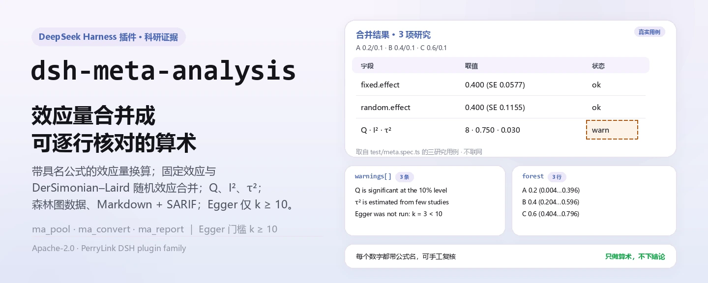
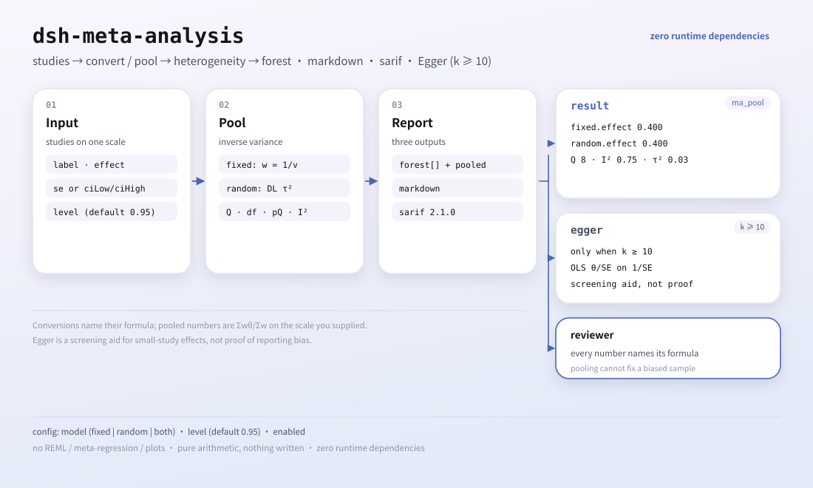
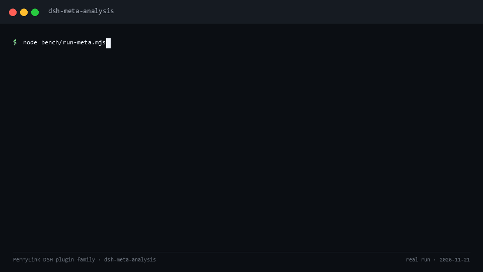

<div align="center">

<picture>
  <source media="(prefers-color-scheme: dark)" srcset="docs/assets/dsh-meta-analysis-hero-zh-dark.webp">
  
</picture>

# dsh-meta-analysis

**把效应量合并起来 —— 每一步算术都能逐行核对。**

*带具名公式的效应量换算、固定效应与 DerSimonian–Laird 随机效应合并、Q / I² / τ²、森林图数据、Markdown + SARIF，以及一项在少于十项研究时拒绝运行的轻量 Egger 检验。*

[English](README.md) · [Español](README-es.md) · [Português](README-pt.md) · [हिन्दी](README-hi.md)

[](LICENSE)
[]()

</div>

---

## 它做什么

- **`ma_pool`** —— 在单一分析尺度上做逆方差合并。固定效应：`w = 1/v`，合并值 `Σwθ/Σw`，`SE = 1/√Σw`。随机效应：DerSimonian–Laird `τ²`，权重 `1/(v+τ²)`。报告 Q、df、p、I²、τ²、各研究权重，以及按所请求置信水平（`level`，默认 0.95）计算的合并 CI/p。
- **`ma_convert`** —— OR⇄logOR、RR⇄logRR（由 CI 求 SE）、d⇄r、d⇄OR（logistic 近似）、由两个均值求 SMD、由 CI 求 SE。每个结果都会注明所用公式及任何近似。
- **`ma_report`** —— 与渲染器无关的森林图数据（效应、CI、权重百分比 + 合并行）、Markdown、SARIF 2.1.0。
- **Egger** —— 仅在 k ≥ 10 时运行：以 `θᵢ/SEᵢ` 对 `1/SEᵢ` 做 OLS；截距用于检验小样本研究效应。它被明确标为筛查辅助手段，而不是发表偏倚的证据。


<picture>
  <source media="(prefers-color-scheme: dark)" srcset="docs/assets/dsh-meta-analysis-flow-v5-dark.svg">
  
</picture>

*结构：输入 → 合并 → 报告；`result`、`markdown`、`sarif` 是三条输出，`level` 取 0.95 以外的值也会如实生效。图内只有工具名与字段名，五语共用同一张结构图。*

## 它不做什么

- **除 DL 外不做模型拟合。** 不支持 REML/Paule–Mandel，不做 meta 回归，不自动做亚组分析或留一法分析（输入由你自行调整），也不做 trim-and-fill。
- **不做偏倚风险判断。** 权重不反映研究质量。
- **不做数据提取。** 效应量与 SE 必须按同一尺度提供；`ma_convert` 可帮助生成。
- **不绘图。** 只提供森林图数据；绘制交给宿主或其他工具。
- **不写证据存储。** 本插件是纯算术：不会向磁盘写入任何内容，README 如实说明这一点，而不是假装存在 REP 记录。

## 公式

| 量 | 公式 |
|---|---|
| 固定效应合并值 | `Σwᵢθᵢ / Σwᵢ`, `wᵢ = 1/vᵢ` |
| 随机效应合并值 | 同上，权重改为 `wᵢ* = 1/(vᵢ + τ²)` |
| Q | `Σ wᵢ(θᵢ − θ_FE)²`, df = k−1 |
| I² | `max(0, (Q − df)/Q)` |
| τ² (DL) | `max(0, (Q − df)/(Σw − Σw²/Σw))` |
| 由 CI 求 SE | `(high − low)/(2·z)` |
| d→r | `d/√(d²+4)` |
| d⇄OR | `exp(d·π/√3)` / `log(OR)·√3/π` |
| SMD | `(m₁−m₂)/s_pooled`, SE `√(1/n₁+1/n₂+d²/(2(n₁+n₂)))` |
| Egger | 以 `θᵢ/SEᵢ` 对 `1/SEᵢ` 做 OLS 的截距，t 检验 df = k−2 |

正态尾部 p 使用 A&S 7.1.26 近似（约 1e-7）；Φ⁻¹ 使用 Wichura AS 241 / PPND16（约 1e-16）；χ² 与 t 使用正则化不完全 gamma/beta 连分数（约 1e-10）。三者都在 `src/math.ts` 中实现，且无依赖。

## 工具

### `ma_pool`

`{ studies: [{label, effect, se?, ciLow?, ciHigh?}], model?, level? }` → `{ ok, result }`。

### `ma_convert`

`{ conversion, value?, low?, high?, level?, mean1?, sd1?, n1?, mean2?, sd2?, n2? }` → `{ ok, result }`。

### `ma_report`

`{ result, measure? }` → `{ ok, forest, markdown, sarif }`。

### 错误码

`INVALID_INPUT`（非有限值、非正的 SE/OR/RR、|r| ≥ 1、SE 与 CI 不一致、k < 2）。

## 兼容性与安装

| | |
|---|---|
| DeepSeek Harness | **`dsh-v0.2.2-rc.4`**（2026-11-18 实测）；peer `>=0.2.1-0 <0.3.0 \|\| >=0.2.2-0 <0.3.0` |
| Node | `^22.19.0 \|\| >=24.9.0`（实测 `24.22.1`），仅 ESM |
| Peer 依赖 | `@perrylink/dsh-research-core ^0.1.0`、`@deepseek-ai/cordis ^4.0.5-alpha.1`、`@deepseek-ai/dsh-tools`、`@deepseek-ai/schemastery ^3.18.5-alpha.1` |
| 运行时依赖 | **零** |

```sh
dsh plugin --profile <name> add @perrylink/dsh-research-core dsh-meta-analysis
dsh --profile <name> --dump-config | grep dsh-meta-analysis
```


> **家族统一 peer 说明：** 尽管本包运行时不 import，`@perrylink/dsh-research-core` 仍作为 peer 声明，以保证整个研究插件家族使用同一套安装契约。

## 配置

| 键 | 默认值 | 含义 |
|---|---|---|
| `enabled` | `true` | `false` 时不挂载任何内容 |
| `model` | `both` | 默认合并模型（`fixed` / `random` / `both`） |
| `level` | `0.95` | 默认置信水平 |

## 评测



*动图是基准适配器的真实 stdout（冻结用例、不联网；2026-11-21 复跑）。期望值来自生成器独立的闭式实现，不是插件输出。*


**23 个单元测试**：特殊函数对照已知临界值（χ²(8,2)=0.9817、t(2.306,8)≈0.05、z(1.96)≈0.05、Φ⁻¹(0.975) 精确到 12 位小数）、换算（logOR+SE、d⇄r、d⇄OR、SMD、不可能输入）、合并（手工计算的固定/随机效应估计，三项研究得到 Q=8、I²=0.75、τ²=0.03）、合并与各研究 CI 按所请求置信水平计算、由 CI 推导 SE 及拒绝 SE/CI 不一致、非法模型/置信水平/研究输入、Egger 在 k=10 时的门控、异质性警告、工具 schema、格式错误报告拒绝、端到端报告、插件契约、包契约、启用/禁用挂载契约。

### 合成元分析基准

**20 组确定性合成基准**（数据集 `meta` v0.1.0，已冻结）位于同工作区的兄弟仓库 `dsh-research-bench` 的 `data/meta` 下，不随本包分发。每组给出研究输入（效应 + SE，或对称 CI）以及 fixed/random 合并、Q、df、pQ、I²、τ² 和 Egger 是否运行的闭式期望值。

覆盖：5 组同质（I²=0，τ²=0）、5 组中等异质、4 组高异质（Q>df，τ²>0）、2 组零效应、2 组负效应、2 组小 k；k=2（4 组）、k=5（5 组）、k=10（6 组）、k=12（5 组）；10 组等 SE、10 组不等 SE；SE、CI 与混合输入。Egger 在 11 组 k≥10（含 k=10 边界）上运行，在 9 组 k<10 上不运行。

适配器逐组调用 `pool(studies, { model: 'both' })`，与生成器独立实现的闭式真值比较（不 import 插件，也不从插件输出反推期望值）。**20/20 全部通过**；绝对误差：

| 量 | 最大绝对误差 | 平均绝对误差 | 阈值 |
|---|---:|---:|---:|
| fixed/random 效应 | 1.11e-16 | 8.33e-18 | 1e-6 |
| fixed/random SE | 2.78e-17 | 1.74e-18 | 1e-6 |
| fixed/random CI | 2.22e-16 | 3.96e-17 | 1e-6 |
| Q | 8.53e-14 | 7.58e-15 | 1e-6 |
| τ² | 8.33e-17 | 6.72e-18 | 1e-6 |
| I² | 2.22e-16 | 1.94e-17 | 1e-9 |
| pQ | 1.67e-15 | 1.96e-16 | 1e-9 |

基准暴露了一个真实的精度上限：旧的 Acklam Φ⁻¹ 在 95% 处偏差 1.6e-9，经 CI 推导的 SE 放大后，两组 case 的 I² 偏差达到 1.12e-9；`normalQuantile` 改用 AS 241 后，Q 的最大误差为 8.5e-14。

```sh
pnpm run build
pnpm run bench:meta        # 读取 ../dsh-research-bench/data/meta（可用 BENCH_DIR 覆盖）
```

输出 `bench/results-meta.json` 与 `bench/results-meta.md`（不含时间戳；重复运行字节一致）。

## 已知限制（v0.1）

- 每次调用只处理一个分析尺度；多尺度协调由调用方负责。
- 已知 DL 的 τ² 在 k 较小时有偏；当 k < 5 时插件会警告。
- Egger 检验假设效应服从正态分布，在少于约 10 项研究时检验效能不足。
- 不提供预测区间（可以在不改变接口的情况下加入）。

## 许可

Apache-2.0。运行时不含第三方代码。
