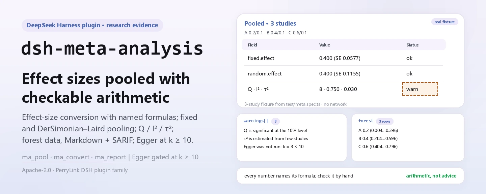
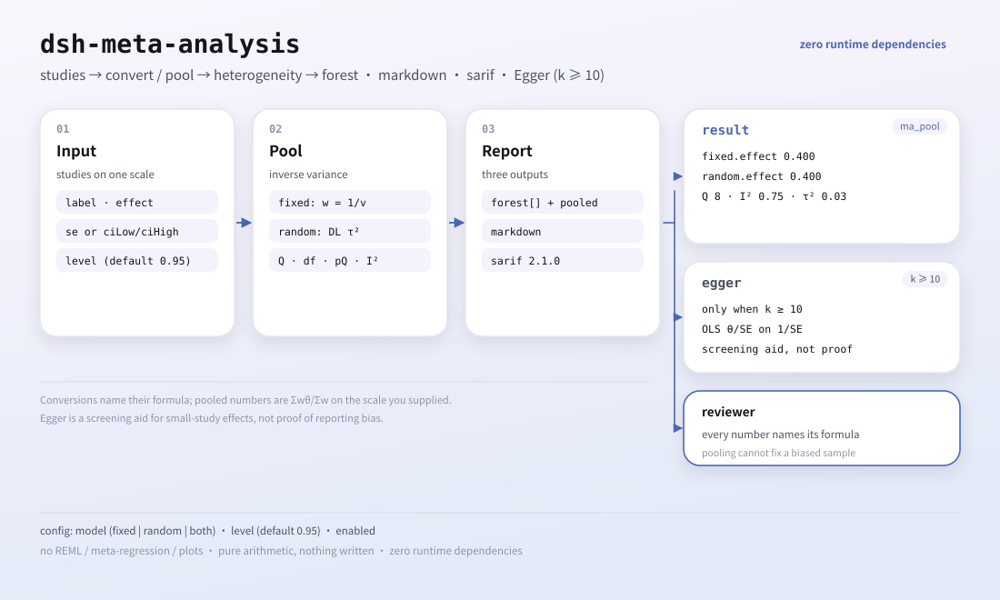
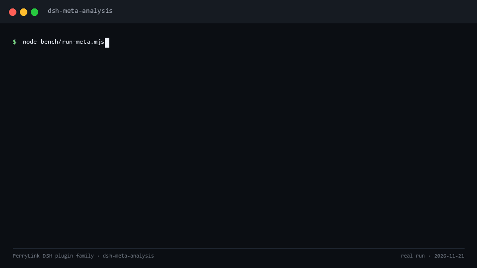

<div align="center">

<picture>
  <source media="(prefers-color-scheme: dark)" srcset="docs/assets/dsh-meta-analysis-hero-en-dark.webp">
  
</picture>

# dsh-meta-analysis

**Pool the effect sizes — with arithmetic you can check line by line.**

*Effect-size conversion with named formulas, fixed-effect and DerSimonian–Laird random-effects pooling, Q / I² / τ², forest-plot data, Markdown + SARIF, and a light Egger test that refuses to run on fewer than ten studies.*

[简体中文](README-zh.md) · [Español](README-es.md) · [Português](README-pt.md) · [हिन्दी](README-hi.md)

[](LICENSE)
[]()

</div>

---

## What it does

- **`ma_pool`** — inverse-variance pooling on one analysis scale. Fixed: `w = 1/v`, pooled `Σwθ/Σw`, `SE = 1/√Σw`. Random: DerSimonian–Laird `τ²`, weights `1/(v+τ²)`. Reports Q, df, p, I², τ², per-study weights and the pooled CI/p at the requested confidence level (`level`, default 0.95).
- **`ma_convert`** — OR⇄logOR, RR⇄logRR (SE from a CI), d⇄r, d⇄OR (logistic approximation), SMD from two means, SE from a CI. Every result names the formula and any approximation.
- **`ma_report`** — renderer-agnostic forest data (effect, CI, weight % + pooled row), Markdown, SARIF 2.1.0.
- **Egger** — only at k ≥ 10: OLS of θᵢ/SEᵢ on 1/SEᵢ; the intercept tests small-study effects. Labelled a screening aid, not proof of reporting bias.


<picture>
  <source media="(prefers-color-scheme: dark)" srcset="docs/assets/dsh-meta-analysis-flow-v5-dark.svg">
  
</picture>

*Structure: input → pool → report; `result`, `markdown` and `sarif` are the outputs, and a `level` other than 0.95 is honoured everywhere. The token labels inside the diagram are the real tool and field names, so the same picture serves all five languages.*

## What it does not do

- **No model fitting beyond DL.** No REML/Paule–Mandel, no meta-regression, no subgroup or leave-one-out automation (the inputs are yours to vary), no trim-and-fill.
- **No risk-of-bias judgement.** Weights do not encode study quality.
- **No data extraction.** Effect sizes and SEs must be supplied on one scale; `ma_convert` helps produce them.
- **No plots.** Forest data is provided; drawing belongs to the host or another tool.
- **No evidence store.** This plugin is pure arithmetic: nothing is written to disk, and the README says so instead of pretending there is a REP record.

## Formulas

| Quantity | Formula |
|---|---|
| Fixed pooled | `Σwᵢθᵢ / Σwᵢ`, `wᵢ = 1/vᵢ` |
| Random pooled | same with `wᵢ* = 1/(vᵢ + τ²)` |
| Q | `Σ wᵢ(θᵢ − θ_FE)²`, df = k−1 |
| I² | `max(0, (Q − df)/Q)` |
| τ² (DL) | `max(0, (Q − df)/(Σw − Σw²/Σw))` |
| SE from CI | `(high − low)/(2·z)` |
| d→r | `d/√(d²+4)` |
| d⇄OR | `exp(d·π/√3)` / `log(OR)·√3/π` |
| SMD | `(m₁−m₂)/s_pooled`, SE `√(1/n₁+1/n₂+d²/(2(n₁+n₂)))` |
| Egger | OLS intercept of `θᵢ/SEᵢ` on `1/SEᵢ`, t with df = k−2 |

Normal-tail p uses an A&S 7.1.26 approximation (~1e-7); Φ⁻¹ uses Wichura's AS 241 / PPND16 (~1e-16); χ² and t use regularized incomplete gamma/beta continued fractions (~1e-10). All are implemented in `src/math.ts` with no dependencies.

## Tools

### `ma_pool`

`{ studies: [{label, effect, se?, ciLow?, ciHigh?}], model?, level? }` → `{ ok, result }`.

### `ma_convert`

`{ conversion, value?, low?, high?, level?, mean1?, sd1?, n1?, mean2?, sd2?, n2? }` → `{ ok, result }`.

### `ma_report`

`{ result, measure? }` → `{ ok, forest, markdown, sarif }`.

### Error codes

`INVALID_INPUT` (non-finite values, non-positive SE/OR/RR, |r| ≥ 1, SE/CI disagreement, k < 2).

## Compatibility & install

| | |
|---|---|
| DeepSeek Harness | **`dsh-v0.2.2-rc.4`** (verified 2026-11-18); peer `>=0.2.1-0 <0.3.0 \|\| >=0.2.2-0 <0.3.0` |
| Node | `^22.19.0 \|\| >=24.9.0` (tested `24.22.1`), ESM only |
| Peers | `@perrylink/dsh-research-core ^0.1.0`, `@deepseek-ai/cordis ^4.0.5-alpha.1`, `@deepseek-ai/dsh-tools`, `@deepseek-ai/schemastery ^3.18.5-alpha.1` |
| Runtime dependencies | **zero** |

```sh
dsh plugin --profile <name> add @perrylink/dsh-research-core dsh-meta-analysis
dsh --profile <name> --dump-config | grep dsh-meta-analysis
```


> **Family-wide peer note:** `@perrylink/dsh-research-core` is declared as a peer for a single, uniform install contract across the research family, even though this package does not import it at runtime.

## Configuration

| Key | Default | Meaning |
|---|---|---|
| `enabled` | `true` | `false` mounts nothing |
| `model` | `both` | default pooling model (`fixed` / `random` / `both`) |
| `level` | `0.95` | default confidence level |

## Evaluation



*Animated: the benchmark adapter's real stdout over the frozen fixtures (no network; re-run 2026-11-21). The expected values are the generator's independent closed form, not plugin output.*


**23 unit tests**: special functions against known critical values (χ²(8,2)=0.9817, t(2.306,8)≈0.05, z(1.96)≈0.05, Φ⁻¹(0.975) to 12 decimal places), conversions (logOR+SE, d⇄r, d⇄OR, SMD, impossible inputs), pooling (hand-calculated fixed/random estimates, Q=8, I²=0.75, τ²=0.03 from three studies), the requested confidence level for pooled and study CIs, CI-derived SE and SE/CI disagreement rejection, invalid models/levels/studies, Egger gating at k=10, heterogeneity warnings, tool schemas, malformed-report rejection, end-to-end report, plugin contract, package contract and the enabled/disabled mount contract.

### Synthetic meta-analysis benchmark

A separate **20-case, deterministic synthetic benchmark** (dataset `meta` v0.1.0, frozen) lives in the sibling `dsh-research-bench` repository under `data/meta`; it is not vendored into this package. Each case supplies studies (effect + SE, or a symmetric CI) and closed-form expected values for fixed/random pooling, Q, df, pQ, I², τ² and Egger presence.

Coverage: 5 homogeneous cases (I²=0, τ²=0), 5 medium- and 4 high-heterogeneity cases (Q>df, τ²>0), 2 zero-effect, 2 negative-effect and 2 small-k cases; k = 2 (4 cases), 5 (5), 10 (6) and 12 (5); 10 equal-SE and 10 unequal-SE designs; SE-only, CI-only and mixed inputs. Egger runs on the 11 cases with k ≥ 10 (including the k=10 boundary) and on none of the 9 below it.

The adapter calls `pool(studies, { model: 'both' })` and compares against the generator's independent implementation (no plugin import, no expected value derived from plugin output). **20/20 cases pass**; absolute errors:

| Quantity | Max abs error | Mean abs error | Tolerance |
|---|---:|---:|---:|
| fixed/random effect | 1.11e-16 | 8.33e-18 | 1e-6 |
| fixed/random SE | 2.78e-17 | 1.74e-18 | 1e-6 |
| fixed/random CI | 2.22e-16 | 3.96e-17 | 1e-6 |
| Q | 8.53e-14 | 7.58e-15 | 1e-6 |
| τ² | 8.33e-17 | 6.72e-18 | 1e-6 |
| I² | 2.22e-16 | 1.94e-17 | 1e-9 |
| pQ | 1.67e-15 | 1.96e-16 | 1e-9 |

The benchmark surfaced one real precision limit: the old Acklam Φ⁻¹ was 1.6e-9 off at 95%, and CI-derived SEs amplified it into I² deviations of 1.12e-9 on two cases. `normalQuantile` now uses AS 241; the largest Q error is 8.5e-14.

```sh
pnpm run build
pnpm run bench:meta        # reads ../dsh-research-bench/data/meta (BENCH_DIR overrides)
```

It writes `bench/results-meta.json` and `bench/results-meta.md` (no timestamps; re-running is byte-identical).

## Known limitations (v0.1)

- One analysis scale per call; multi-scale harmonisation is the caller's job.
- DL τ² is known to be biased at small k; the plugin warns when k < 5.
- The Egger test assumes a normal distribution of effects and is underpowered below ~10 studies.
- No prediction interval (could be added without changing the interface).

## License

Apache-2.0. No third-party runtime code.
